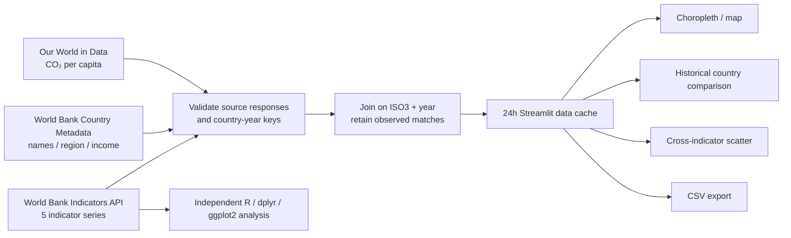

# 🌍 Global Development Atlas
### The geography of economic growth, human development, and emissions

**An interactive, multi-source global intelligence dashboard powered by real published country-year observations.** Explore how economic development, population, health, energy and carbon emissions vary across countries and through time.


> **Verification note:** Five Python tests passed in the preparation environment. GitHub Actions, live external API retrieval, R execution and Streamlit rendering have **not yet been verified**. No benchmark, dataset size, deployment URL or screenshot is invented.

## Why this project?

Economic indicators and environmental impacts are often examined in disconnected systems. This research-style dashboard integrates **two independent real-data publishers** into one country-year model, allowing users to investigate geographic and historical patterns **without implying causal relationships**.

**Intended users:** data analysts, public policy researchers, environmental analysts, and students studying international development.

## Application features

| Workspace | User interaction | Output |
|---|---|---|
| **Global choropleth** | Choose a metric, reporting year, and regions | Interactive geographic overview |
| **Country comparison** | Select countries | Historical multi-country trends |
| **Economic / environmental relationship** | Choose a World Bank measure | Country scatterplot versus CO₂ per capita |
| **Data explorer** | Filter regions and years | Observed joined records and downloadable CSV |
| **Provenance panel** | Inspect source context and coverage | True record count, country count and date range |
| **Independent R analysis** | Run an R script | Life-expectancy histogram and observed-data CSV |

The application uses a restrained dark-blue / teal visual system, headline KPIs, interactive Plotly visualizations and a wide-layout Streamlit dashboard. No image is provided as an actual screenshot until rendering has been verified.

## Data architecture



**Data model:** World Bank indicator observations and OWID emissions are joined on **ISO 3166-1 alpha-3 country codes and calendar years**, then enriched with World Bank country metadata. Aggregate entities are excluded. All joins validate key cardinality. Missing observations are excluded rather than interpolated.

## Actual public data sources

| Publisher | Dataset / API | Purpose |
|---|---|---|
| World Bank | [Indicators API](https://api.worldbank.org/v2/country/all/indicator/SP.POP.TOTL?format=json) | Population, total GDP, GDP per capita, life expectancy, renewable electricity |
| World Bank | [Country metadata](https://api.worldbank.org/v2/country?format=json) | Country names, ISO3 identifiers, region and income grouping |
| Our World in Data | [CO₂ emissions per capita CSV](https://ourworldindata.org/grapher/co2-per-capita.csv) | Historical emissions per person |

**World Bank indicator codes:** `NY.GDP.MKTP.CD`, `SP.POP.TOTL`, `NY.GDP.PCAP.CD`, `SP.DYN.LE00.IN`, `EG.ELC.RNEW.ZS`.

- **Requested time range:** 1990–2026 where the publisher has real observations; no 2026 values are invented.
- **Actual data volume:** calculated from the source response when the application runs; no unverified row count is claimed.
- **Refresh behavior:** live API retrieval on cache miss, then a 24-hour Streamlit data cache.
- **Source permissions:** follow the publishers' attribution and reuse policies. This repository does **not** redistribute extracted raw datasets.
- **No mock data in the application:** minimal deterministic records occur solely inside isolated unit tests to verify logic.

## Technology stack

**Dashboard:** Python 3.12, Streamlit, Plotly Express, Pandas, custom CSS.

**Ingestion & contracts:** Requests, World Bank JSON API, OWID Grapher CSV, explicit key validation and deduplicated country metadata.

**Scientific / statistical companion:** R, jsonlite, dplyr, ggplot2 (not required for the Python application).

**Reproducibility & delivery:** Docker, pytest, GitHub Actions.

The architecture is deliberately modest: for this project, a separate web API and database would increase operational complexity without providing a clear benefit over validated source fetching and a cached analytical layer.

## Quick start

```bash
git clone https://github.com/nazirreally/global-development-atlas.git
cd global-development-atlas
python -m venv .venv
```

Activate your virtual environment:

```bash
# Linux / macOS
source .venv/bin/activate

# Windows PowerShell
# .venv\Scripts\Activate.ps1
```

Install dependencies and launch:

```bash
python -m pip install -r requirements.txt
streamlit run app.py
```

Open **http://localhost:8501**. An internet connection is required to download real data; if a source is unreachable, the app clearly reports the failure rather than generating false observations.

### Docker

```bash
docker build -t global-development-atlas .
docker run --rm -p 8501:8501 global-development-atlas
```

### R analysis (optional)

```r
install.packages(c("jsonlite", "dplyr", "ggplot2"))
```
```bash
Rscript r/geospatial_analysis.R
```

The R script fetches real World Bank life-expectancy observations, constructs a latest-observation distribution, and writes a PNG and CSV to **outputs/**. It has **not been executed here** because an R runtime was unavailable.

## Testing and CI

```bash
python -m pip install -r requirements-dev.txt
python -m pytest -q
python -m compileall -q app.py atlas
```

**Verification performed:** five Python unit tests passed locally, covering temporal join behavior, duplicate-key rejection, unsupported indicator rejection, malformed World Bank payloads, and OWID CSV contract changes.

The GitHub Actions workflow is configured to run pytest and source compilation on push and pull requests. Its result must be checked in the [Actions tab](https://github.com/nazirreally/global-development-atlas/actions); **CI success is not assumed**.

## Repository layout

```text
global-development-atlas/
├── app.py                      # Streamlit dashboard / filters / charts
├── atlas/
│   ├── __init__.py
│   └── data.py                 # Two-publisher ingestion, contracts, joins
├── r/
│   └── geospatial_analysis.R   # Independent observed-data R analysis
├── tests/
│   └── test_data.py            # Isolated deterministic unit tests
├── .github/workflows/
│   └── ci.yml                  # Tests + Python compilation
├── Dockerfile
├── requirements.txt
├── requirements-dev.txt
└── README.md
```

## Engineering decisions and known limitations

1. **Join coverage versus completeness:** the inner join intentionally removes country-years without both observations. A coverage audit is a useful future feature.
2. **Interpretation:** co-occurrence and correlation are not causation; GDP scales and emissions methods require careful reading.
3. **Source revisions:** both publishers may revise historical series. Reproducing an exact historical result requires pinned download snapshots and fetch metadata.
4. **Country identifiers:** ISO3 mapping and differences in geographic coverage can exclude some territories.
5. **Data freshness:** the newest reporting year differs by indicator. A country may lack data for the requested year.
6. **Deployment testing:** live network calls, Streamlit rendering, the R companion, and Docker were not verified in the preparation environment.

## Roadmap

- [ ] Validate real API ingestion against a full live dataset and record observed counts
- [ ] Add missingness / source overlap and update-date audit panels
- [ ] Capture reproducible data snapshot manifests and checksums
- [ ] Add Streamlit AppTest and a Docker health-check smoke test
- [ ] Add an integrated R Shiny geographic analysis view using **sf** and Leaflet
- [ ] Offer a shareable live deployment after runtime validation

---

**Integrity statement:** Every displayed analytical observation originates from a real published dataset. No simulated data, fabricated records, artificial benchmark numbers, or unverified visuals are presented as factual results.
