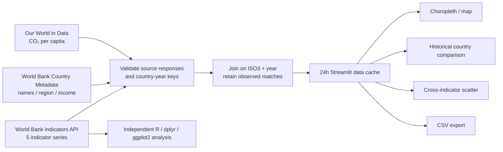

# 🌍 Global Development Atlas
### The geography of economic growth, human development, and emissions

**An interactive, multi-source global intelligence dashboard powered by real published country-year observations.** Explore how economic development, population, health, energy and carbon emissions vary across countries and through time.


> **Verification note:** The current 13-test Python suite passed locally on 2026-11-22 (analytics transformations and source-contract tests). Source compilation also passed. Streamlit runtime rendering, full live API retrieval, R execution, and GitHub Actions success are **not yet verified**. No benchmark, dataset size, deployment URL or screenshot is invented.

## Why this project?

Economic indicators and environmental impacts are often examined in disconnected systems. This research-style dashboard integrates **two independent real-data publishers** into one country-year model, allowing users to investigate geographic and historical patterns **without implying causal relationships**.

**Intended users:** data analysts, public policy researchers, environmental analysts, and students studying international development.

## Intelligence Studio v2 — interactive workspaces

The dashboard is deliberately structured as a **four-workspace research tool**, not a static collection of charts. A custom midnight-navy / mint / violet visual system adds a branded hero, dynamic KPI cards, responsive layout and high-contrast Plotly charts.

| Workspace | Interactions | Analytical views |
|---|---|---|
| **◎ World Explorer** | Reporting year, primary indicator, region, income group, map mode, projection and color palette | Choropleth or proportional-circle map, ranking direction and top-N, regional distributions |
| **⌁ Country Studio** | Up to any number of selected countries, history start, observed baseline, raw versus indexed comparison | Multiseries interactive history and exact adjacent-year percentage changes |
| **◈ Relationships** | Independently select both axes, toggle observed population bubble sizes, refine country scope | Multivariate country bubble chart, matched-country count, Pearson correlation |
| **▦ Data Lab** | Change reporting scope and export date window | True country-year counts, per-source completeness, reporting coverage timeline, country-level records and CSV export |

**Interactive controls** are genuine Streamlit widgets. Plotly figures support native hover, zoom, panning and interactive legend behavior. The Streamlit application loads publisher datasets with a 24-hour cache, but does not generate synthetic observations.

### How to review

1. Start the app (or open its deployed URL). Use the **Primary indicator** and **Reporting year** controls in the left sidebar.
2. In **World Explorer**, switch between **Choropleth** and **Proportional circles**, try **Orthographic** projection, and change the color palette.
3. In **Country Studio**, compare Pakistan, India, China, the United States and Germany; turn on **Index countries to a common baseline** to study relative trajectories.
4. In **Relationships**, select GDP per capita on X and CO₂ per capita on Y; enable population-sized circles to expose scale differences.
5. In **Data Lab**, review the actual observation counts by indicator, missingness over time and export the filtered country-year records.

**Important:** These are implemented code paths, not visually verified screenshots. The revised app still requires a live Streamlit deployment smoke test to validate the appearance and behavior in a browser.

## Data architecture



**Data model:** World Bank indicator observations and OWID emissions are joined on **ISO 3166-1 alpha-3 country codes and calendar years**, then enriched with World Bank country metadata. Aggregate entities are excluded. All joins validate key cardinality. Missing observations are excluded rather than interpolated.

## Actual public data sources

| Publisher | Dataset / API | Purpose |
|---|---|---|
| World Bank | [Indicators API](https://api.worldbank.org/v2/country/all/indicator/SP.POP.TOTL?format=json) | Population, total GDP, GDP per capita, life expectancy, renewable electricity |
| World Bank | [Country metadata](https://api.worldbank.org/v2/country?format=json) | Country names, ISO3 identifiers, region and income grouping |
| Our World in Data | [CO₂ emissions per capita CSV](https://ourworldindata.org/grapher/co-emissions-per-capita.csv) | Historical emissions per person |

**World Bank indicator codes:** `NY.GDP.MKTP.CD`, `SP.POP.TOTL`, `NY.GDP.PCAP.CD`, `SP.DYN.LE00.IN`, `EG.ELC.RNEW.ZS`.

- **Requested time range:** 1990–2026 where the publisher has real observations; no 2026 values are invented.
- **Actual data volume:** calculated from the source response when the application runs; no unverified row count is claimed.
- **Refresh behavior:** live API retrieval on cache miss, then a 24-hour Streamlit data cache.
- **Source permissions:** follow the publishers' attribution and reuse policies. This repository does **not** redistribute extracted raw datasets.
- **No mock data in the application:** minimal deterministic records occur solely inside isolated unit tests to verify logic.

## Technology stack

**Dashboard:** Python 3.12, Streamlit, Plotly Express, Pandas, custom CSS.

**Ingestion & contracts:** Requests, World Bank JSON API, OWID Grapher CSV, explicit key validation and deduplicated country metadata.

**Scientific / statistical companion:** R, jsonlite, dplyr, ggplot2 (not required for the Python application).

**Reproducibility & delivery:** Docker, pytest, GitHub Actions.

The architecture is deliberately modest: for this project, a separate web API and database would increase operational complexity without providing a clear benefit over validated source fetching and a cached analytical layer.

## Quick start

```bash
git clone https://github.com/nazirreally/global-development-atlas.git
cd global-development-atlas
python -m venv .venv
```

Activate your virtual environment:

```bash
# Linux / macOS
source .venv/bin/activate

# Windows PowerShell
# .venv\Scripts\Activate.ps1
```

Install dependencies and launch:

```bash
python -m pip install -r requirements.txt
streamlit run app.py
```

Open **http://localhost:8501**. An internet connection is required to download real data; if a source is unreachable, the app clearly reports the failure rather than generating false observations.

### Docker

```bash
docker build -t global-development-atlas .
docker run --rm -p 8501:8501 global-development-atlas
```

### R analysis (optional)

```r
install.packages(c("jsonlite", "dplyr", "ggplot2"))
```
```bash
Rscript r/geospatial_analysis.R
```

The R script fetches real World Bank life-expectancy observations, constructs a latest-observation distribution, and writes a PNG and CSV to **outputs/**. It has **not been executed here** because an R runtime was unavailable.

## Testing and CI

```bash
python -m pip install -r requirements-dev.txt
python -m pytest -q
python -m compileall -q app.py atlas
```

**Verification performed:** 13 current Python unit tests passed locally, including World Bank/OWID contracts, multi-source panel construction, missingness, index rebasing and adjacent-year comparisons, covering temporal join behavior, duplicate-key rejection, unsupported indicator rejection, malformed World Bank payloads, and OWID CSV contract changes.

The GitHub Actions workflow is configured to run pytest and source compilation on push and pull requests. Its result must be checked in the [Actions tab](https://github.com/nazirreally/global-development-atlas/actions); **CI success is not assumed**.

## Repository layout

```text
global-development-atlas/
├── app.py                      # Four interactive Streamlit workspaces and custom visual system
├── atlas/
│   ├── __init__.py
│   ├── data.py                 # Two-publisher ingestion, contracts, joins
│   └── analytics.py            # Multi-indicator panel, coverage, indexes, annual changes
├── r/
│   └── geospatial_analysis.R   # Independent observed-data R analysis
├── tests/
│   ├── test_data.py            # Publisher parsing / contract tests
│   └── test_analytics.py       # Pure analytical transformation tests
├── .github/workflows/
│   └── ci.yml                  # Tests + Python compilation
├── Dockerfile
├── requirements.txt
├── requirements-dev.txt
└── README.md
```

## Engineering decisions and known limitations

1. **Join coverage versus completeness:** the inner join intentionally removes country-years without both observations. A coverage audit is a useful future feature.
2. **Interpretation:** co-occurrence and correlation are not causation; GDP scales and emissions methods require careful reading.
3. **Source revisions:** both publishers may revise historical series. Reproducing an exact historical result requires pinned download snapshots and fetch metadata.
4. **Country identifiers:** ISO3 mapping and differences in geographic coverage can exclude some territories.
5. **Data freshness:** the newest reporting year differs by indicator. A country may lack data for the requested year.
6. **Deployment testing:** live network calls, Streamlit rendering, the R companion, and Docker were not verified in the preparation environment.

## Roadmap

- [ ] Validate real API ingestion against a full live dataset and record observed counts
- [ ] Add missingness / source overlap and update-date audit panels
- [ ] Capture reproducible data snapshot manifests and checksums
- [ ] Add Streamlit AppTest and a Docker health-check smoke test
- [ ] Add an integrated R Shiny geographic analysis view using **sf** and Leaflet
- [ ] Offer a shareable live deployment after runtime validation

---

**Integrity statement:** Every displayed analytical observation originates from a real published dataset. No simulated data, fabricated records, artificial benchmark numbers, or unverified visuals are presented as factual results.

### 2026-11-22: OWID source URL correction

A deployed user session exposed an HTTP 404 at the previous, incorrect CO₂ per-capita CSV slug. The connector now uses the [published OWID Grapher endpoint](https://ourworldindata.org/grapher/co-emissions-per-capita.csv), and regression tests guard against accidentally restoring that broken slug. Live deployment validation is still required; tests do not imply live API availability.

### 2026-11-22 — Studio v2 UX redesign

Added four dedicated interactive workspaces, map modes and projection choices, ranking and distribution visuals, country trend indexing, observed adjacent-year change, two-axis indicator exploration, weighted bubble sizes from real population measurements, and source coverage audit. Added `atlas/analytics.py` and six unit tests. The full 13-test Python suite passed locally; **the live Streamlit rendering and CI run are not claimed as verified**.
